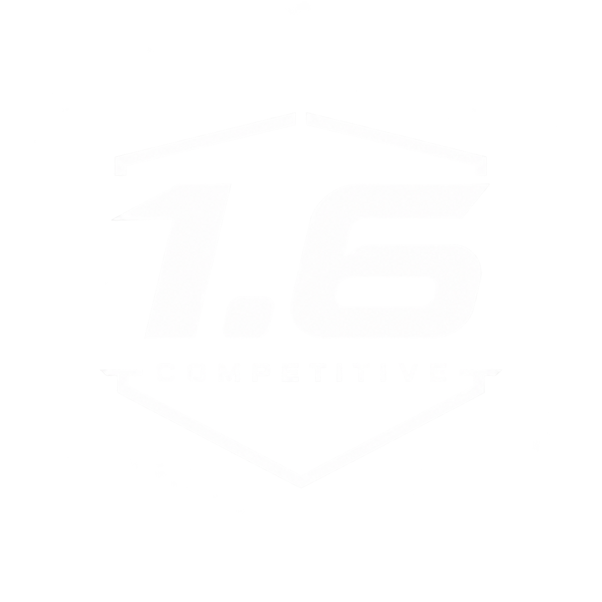

# 1.6 Competitive

  
  
<strong>Classic aim. Modern competition.</strong>

  
A Counter-Strike 1.6 matchmaking platform with a desktop launcher for Windows and Linux.

  <a href="https://www.papamo.dev/1.6competitive">Website</a>
  · <a href="https://github.com/keenplify/16competitive-client/releases">Download</a>
  · <a href="https://discord.gg/uZwKyf2EHp">Discord</a>
  · <a href="https://github.com/keenplify/16competitive-client/issues">Report an issue</a>

## Play the classic, together

1.6 Competitive is in active alpha development. Find teammates, queue for matches,
customize your loadout, and connect to assigned servers from one launcher.
Available modes, maps, rewards, and regional capacity are controlled by the
platform and may change during the alpha.

- **Matchmaking:** competitive 5v5, with additional modes such as Unrated, Legacy,
  3v3, FFA, and Arena when enabled. Follow queue status, accept ready checks,
  and reconnect to active matches.
- **Parties and friends:** invite teammates, chat, and queue together.
- **Profiles and rankings:** view MMR, match history, results, and leaderboards.
- **Cosmetics:** browse your inventory, equip weapon skins, and prepare required
  match assets before connecting.
- **Operations and rewards:** follow active operations, including First Wave,
  and claim rewards as you progress.
- **Regional play:** select available servers in North America, Europe East,
  Southeast Asia, and South America.
- **Desktop integration:** game installation selection, automatic launching,
  launcher updates, and Discord Rich Presence.

The launcher interface includes **Português (Brasil)**. In-game text chat can
also be translated into Brazilian Portuguese (`pt-br`) through **Settings**.
Translation keeps the original message visible and may arrive afterward.

## Get started

1. Download an official build from [Releases](https://github.com/keenplify/16competitive-client/releases).
2. Sign in and select your Counter-Strike 1.6 installation in **Settings**.
3. Choose an available region and mode, invite friends if you want, and join the queue.
4. Accept the ready check and let the launcher prepare assets before connecting.

A compatible Counter-Strike 1.6 installation is required for desktop play.
Steam and supported No-Steam installations can be selected. The launcher does
not include Counter-Strike itself.

Windows builds use the installer provided in Releases. Linux builds are
available as AppImages for x64 and ARM64, including modern ARM Linux devices
such as Asahi Linux. Compatibility still depends on the selected game
installation. AppImages support automatic launcher updates; DEB and Snap
packages do not. macOS is not currently a supported release target.

Prefer the browser? Open [Web Play](https://16competitive.papamo.dev/web).
Administrators control the available browser modes; ranked 5v5 awards MMR there
when enabled. Full game-launching and desktop integrations require the launcher.

## Optional in-game enhancements

Managed sessions can provide a custom scoreboard, HUD, teammate indicators,
player pings, and crosshair controls where the game installation and packaged
native module support them. Availability depends on the platform, game build,
and matching server and helper versions.

On Linux, native Steam launches use the Linux module. When Steam explicitly selects
Proton, the launcher uses the signed Windows proxy and the selected Proton version
in app 10’s library-specific prefix. Recovery retains that prefix across launcher
updates and runtime-setting changes. Steam compatibility preferences are preserved.
Recovery supervision stays outside Wine during play and invokes the approved
Windows restoration helper after game exit, so it does not keep Steam's prefix
busy between matches. Native session tickets, heartbeat expiry, and server
endpoint authorization remain enforced by the module.

The crosshair editor imports current CS2 `CS…` share codes and converts older
`CSGO-…` codes using the MIT-licensed
[csgo-sharecode decoder](https://github.com/akiver/csgo-sharecode).
CS2 spread and scope behavior are approximated from available GoldSrc state;
rendering imported codes requires a compatible native module.

**Do not run 1.6 Competitive alongside another client-side anti-cheat.** Close
the managed game and launcher, then start the game normally before using
another anti-cheat client. Third-party anti-cheat compatibility is not claimed.
Native features are scoped to authorized managed sessions. The new CS 1.6 source
path retains verified Windows/NextClient modules after game exit and cleans up
session workers and temporary credentials. Original DLL backups remain available
for explicit maintenance; automatic restoration and standalone restart are removed.
This requires a coordinated approved helper release. See the
[PAPAMOVGUI2 developer docs](https://www.papamo.dev/docs/papamovgui2) for interfaces,
animation architecture and release status.

## Configuration and diagnostics

`config.cfg` belongs to the player and Counter-Strike. The launcher must never
read, write, create, replace, append to, rename, delete, back up, restore, or
otherwise manipulate it. Match-specific commands use launcher-owned files such
as `16competitive_match.cfg`, launch arguments, or isolated native mechanisms.

Local diagnostic logs cover connectivity, asset preparation, and game launching. A bounded local
launch history also survives launcher restarts: queue requests, connect events,
auto-launch decisions, preparation phase changes, helper failures (including OS
error and Windows helper elevation status when available), and UAC outcomes.
Entries carry launcher-run and launch-attempt IDs. Up to 256 events remain
eligible for reporting for six hours; repeated socket updates are deduplicated.
History uses account-hashed filenames, keeps at most five account files, and
prunes expired records on access and stale files on the next write. Reports
include only the currently signed-in account's history, even with no active
match. No passwords, login/session tokens, raw launch arguments, chat, or game
configuration are stored in this history. Upload happens only through the
existing issue-report submission flow.
Native `NATIVE_INSTALL_UNSUPPORTED` launch failures automatically submit a bounded issue report
after cleanup, using the active helper session. Reports include the match, game, helper version,
platform, helper/Windows architecture and emulation status, fixed compatibility-check reason,
and inspected client DLL SHA-256 when available.
They never upload DLL contents, arbitrary files, installation paths, or connection credentials.
Repeated attempts are deduplicated per account, match, and helper version; submission uses two
bounded attempts and never changes the launch result if reporting fails.

Persistent scoreboard or connection failures can submit automatic issue reports
with relevant launcher/session diagnostics. During the first five minutes of a
managed CS 1.6 launch, the launcher checks newly appended `qconsole.log` output
once per second for `Info string length exceeded`. That error automatically
submits a report with a per-match deduplication key and up to three upload attempts.
Existing log content does not trigger reports; credentials remain redacted.
Monitoring ends with the managed session and is scoped to the signed-in account.
Submitted issue reports can also
include recent native HUD-cadence FPS samples when available; these estimate
game HUD cadence, not GPU timing or launcher-renderer FPS. Missing samples are
reported as unavailable. Arbitrary local files are not collected for reports.

## About this repository

This public repository contains the Electron desktop client and its renderer.
The stack includes TypeScript, React, Vite, Tailwind CSS, and Zustand. The
renderer uses narrow preload/IPC APIs; filesystem access, asset preparation,
and game launching belong in the main process.

The backend remains authoritative for identity, matchmaking, MMR, inventory
ownership, match results, bans, and server assignment. The separate backend and
private native helper are not included here. This repository alone is not the
complete platform or a self-contained replacement for the official client.

Source is published for inspection. Use the official releases to play. Building,
running, modifying, or reusing the source requires separate written permission.
See [AGENTS.md](AGENTS.md) for architecture and security rules, and [docs](docs)
for integration details relevant to authorized maintainers.

Authorized maintainers on the configured Fedora build host can use
`npm run dev:vm` to open the existing Windows VM and run the current source there.
See [Windows VM development](docs/dev-vm.md) for sign-in, local backend forwarding,
source sync, and graphics requirements.

## Feedback

Bug reports and player feedback are welcome through
[Issues](https://github.com/keenplify/16competitive-client/issues) or
[Discord](https://discord.gg/uZwKyf2EHp). Include your launcher version,
platform, what happened, and steps to reproduce. Do not include account tokens,
passwords, or other secrets. Contact us before proposing source changes; the
view-only license does not authorize modifications or contributions by default.

## License — view only

The original project material is proprietary and provided under the
[View-Only Source License](LICENSE). You may inspect it for personal
informational purposes. **No permission is granted to build, run, modify, fork,
redistribute, sell, or reuse it without prior written authorization.**

GitHub's terms independently allow platform forks of public repositories;
this license cannot disable that functionality and grants no additional rights
to use or distribute a fork. The private helper is not included and does not
prevent copying the public source. Third-party components retain their own
licenses. Official prebuilt releases remain subject to their separately granted
end-user permissions.

Counter-Strike and Steam are trademarks and/or registered trademarks of Valve
Corporation. 1.6 Competitive is independent and is not affiliated with or
endorsed by Valve Corporation.

Loadout includes stock weapons alongside owned skins. Right-click a weapon and choose Preview for the detailed v_ inspection view, or switch to First Person. Weapon cards share the inspection presentation. Versioned thumbnail keys invalidate older p_ previews automatically. Saved stickers appear on the matching weapon variant in Loadout previews and cards. Inventory contains unused stickers and consumables; buy stickers in Store. Sticker authoring supports the 28 hash-pinned Steam CS 1.6 stock weapon viewmodels, including pistols, rifles, grenades and knife. MP5 uses the `mp5navy` weapon key and `v_mp5.mdl` file. Owned custom weapon skins use the same editor with validated model geometry and authoritative source hashes. The current 54 custom catalog models pass atlas and projected-sticker bake validation. Incompatible future models fail validation before application; p_/w_ sticker rendering is not enabled. Custom delivery uses the v2 source-hash manifest and requires a matching approved helper release.

Full-color sticker previews preserve RGBA artwork instead of reducing it to the
MDL palette. Managed launches also stage content-addressed `.rgba` sidecars and
an optional `sticker-textures.tsv` manifest; older helpers retain the indexed MDL
fallback. The new native RGBA receiver is source-only pending an approved helper
release and in-game verification on classic Linux/Windows and NextClient.
Inspection thumbnails use cache namespace `viewmodel-inspection-v4`; the stock
USP uses its animated idle pose and stock M3 reload-shell geometry is hidden only
in inspection views, leaving first-person animations and source files intact.

Admin rotation preview is exported with `node scripts/export-admin-weapon-preview.mjs` to the sibling admin repository. Inspection and static first-person `v_` views share the launcher renderer. A bounded 512×512 depth pass marks the inspection-visible triangles yellow in both views; this is an orientation guide, not game lighting. Unsaved angles change inspection presentation and the mask, never the first-person pose.

Browser/PWA issue reports use the native settings bridge to preview compatibility files and
request consent before uploading them. The helper keeps one fixed-allowlist snapshot (up to
16 MiB per file, 64 MiB total) for ten minutes, scoped to the API origin and authenticated
session. Only approved snapshots are sent directly to the authenticated report attachment
endpoint; DLL contents are never exposed to browser JavaScript. Failed uploads remain errors
and retry against the same report key. An unavailable helper shows a preparation error and
allows submitting logs without files.

Automatic native installation compatibility reports also run after a successful
fallback launch, marked `NATIVE_INSTALL_UNSUPPORTED` with
`launchOutcome: launched_with_fallback` and `blocking: false`. These reports
attach native libraries directly inside the selected game's `cl_dlls` folder
without a consent dialog (owner-requested diagnostic policy). Collection excludes
subdirectories, symlinks, configs and non-library files, prioritizes `client.dll`,
and retains the existing limits of seven files, 16 MiB per file and 64 MiB total.
The private report storage deduplicates hashes and retains files for 30 days.
Network/upload failures do not interrupt a running game.
